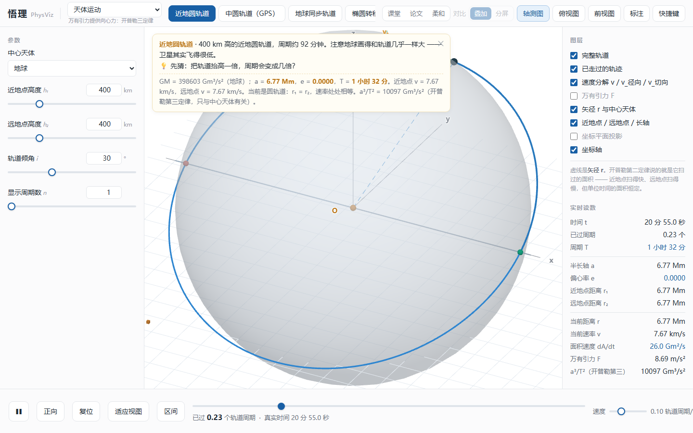
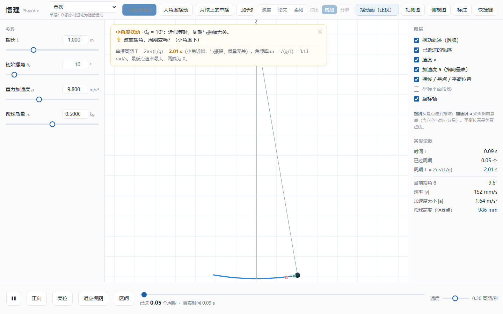

# PhysViz · 悟理

> 高中物理三维模型，送给丁老师的教学用具（老师觉得不好用，没用）

面向高中/大学物理教学的可交互三维可视化模型集：Three.js 渲染，物理层与渲染层分离，自带物理正确性测试、文档校验和截图回归脚本。




## 包含哪些模型

| 模型 | 文件 |
|---|---|
| 单摆 | `src/models/pendulum.js` |
| 圆锥摆 | `src/models/conical-pendulum.js` |
| 简谐运动 | `src/models/shm.js` |
| 平抛 / 斜抛 | `src/models/projectile.js` |
| 轨道运动（霍曼转移等） | `src/models/orbit.js` |
| 回旋加速器 | `src/models/cyclotron.js` |
| 电场偏转 | `src/models/electric-deflection.js` |
| 磁场中的圆周运动 | `src/models/magnetic-circle.js` |
| 碰撞 | `src/models/collision.js` |
| 速度选择器 | `src/models/velocity-matching.js` |

## 快速开始

**只看效果**：直接用浏览器打开 `dist/index.html`（单文件、离线可用）。

**改代码**：

```bash
npm install
npm run build     # esbuild 打包 -> dist/app.js，再内联成 dist/index.html
```

如果 `npm run build` 报错，多半是打包参数和原来的不一致：检查 `src/index.html` 里 `app.js` 的引入方式（`<script>` 还是 `<script type="module">`），据此调整 `package.json` 里的 `--format`。

**跑测试**：

```bash
npm test              # 物理正确性测试（不需要浏览器）
npm run test:smoke    # 界面冒烟测试（需要无头浏览器）
```

## 目录结构

```
src/            源码
  index.html    页面骨架
  main.js       入口与场景装配
  physics.js    物理计算
  core/         渲染工具、模型注册表、主题
  models/       10 个物理模型
scripts/        构建内联、物理审计、截图回归、文档校验
shots/          截图（部分是回归基线）
dist/           构建产物（单文件 HTML）
DESIGN.md       设计文档
```

## 设计文档

`DESIGN.md` 记录了这个项目的设计取舍：模型怎么抽象、参数怎么暴露、视觉风格怎么统一、哪些物理量必须可验证。比代码更值得先读。

## 质量保障

- `scripts/test-physics.mjs`：物理正确性测试（守恒量、边界条件、解析解对照）
- `scripts/check-magnitude.mjs`、`check-framing.mjs`：数值量与取景的自动检查
- `scripts/smoke.mjs`：界面冒烟测试
- `scripts/shoot*.mjs`：截图回归
- `scripts/verify-doc.mjs`：文档与实现一致性校验

## Roadmap

- [ ] GitHub Actions：push 时自动跑 build + test
- [ ] GitHub Pages：在线 demo
- [ ] 每个模型补一张截图和一个 30 秒演示

## 说明

教学用途项目，非官方教材或考试依据。
